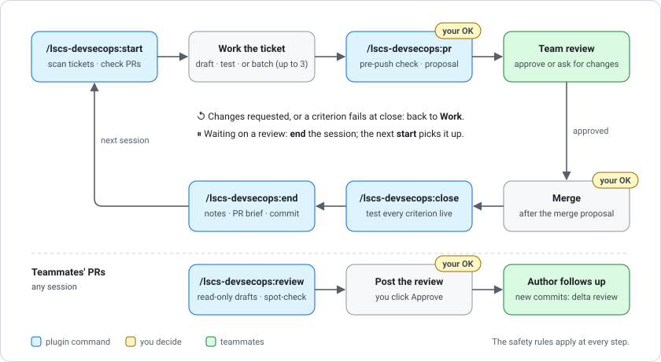

<div align="center">

# lscs-devsecops

[](https://docs.claude.com/en/docs/claude-code/plugins)
[](LICENSE)

A Claude Code plugin for **LSCS (dlsu-lscs) DevSecOps work**: the org's contribution rules, safety rules for letting Claude act on GitHub, and a notebook for working through your assigned tickets across sessions.

[Overview](#overview) • [How it works](#how-it-works) • [Getting started](#getting-started) • [Configuration](#configuration)

</div>

> [!NOTE]
> This is a fork of [Enzo-user/lscs-devsecops](https://github.com/Enzo-user/lscs-devsecops), maintained by [@aq7zo](https://github.com/aq7zo).

## Overview

The plugin is built for LSCS DevSecOps engineers and the tickets they're assigned: CI/CD workflows, Dockerfiles and Compose files, branch protection and rulesets, secrets and repository setup. The Senior DevSecOps is the primary reviewer for that work (CCG §10, §16).

It isn't meant for general frontend or backend work. The conventions apply to everyone, but the review routing, safety rules and ticket notebook are set up for DevSecOps. Frontend and backend PRs go to the Project Tech Lead (CCG §10).

| Part | What it does |
|---|---|
| Safety rules (always on) | Loaded at every session start, and again after `/clear` and compaction. They say what Claude does alone, what needs your OK first (pushes, PRs, merges, replies to people) and what only humans do (approving PRs, secrets, org settings). The admin bypass is never used. |
| `/lscs-devsecops:conventions` | The Code Contribution Guidelines and CQA / DevSecOps Standard V2.1.0 in short: branches, commits, PR template, reviews, merge method, CI security, action pinning, images, secrets. Claude loads it by itself when you branch, commit, or write a PR, a workflow or a Dockerfile. |
| `/lscs-devsecops:start` | Reads your `HANDOFF.md`, scans the issues assigned to you, takes in and ranks new ones, checks your PRs for reviews and merges, and reports what's next. |
| `/lscs-devsecops:pr` | Runs a pre-push check, then shows a PR proposal you approve before anything is pushed. Handles review follow-up, then proposes the merge once a qualified reviewer has approved. |
| `/lscs-devsecops:close` | Tests every acceptance criterion live, records the evidence, closes the ticket and writes a test report for the team. |
| `/lscs-devsecops:end` | Updates `HANDOFF.md` and the ticket notes, gives you a 3-line brief per PR and commits your notes. |

## How it works

Each session starts with `start` and ends with `end`. A ticket goes around the loop until every acceptance criterion is proven. A PR waiting on review carries over, and the next session's `start` picks it up.



> [!IMPORTANT]
> Nothing is pushed, merged or posted for you without your OK. The safety rules apply whether or not a command is running.

## Getting started

### Requirements

- Claude Code with GitHub access: the [`gh` CLI](https://cli.github.com/) (logged in), or the GitHub MCP server.
- Optional: a browser automation tool (for issue screenshots and settings pages), and Chrome or Edge to print test reports to PDF.

> [!TIP]
> On Windows, the plugin is tested with Git Bash. PowerShell is untested; open an issue if the rules don't load.

### Install

In Claude Code, in the folder where you work (your notes repo or a product repo), run these as two separate commands:

1. Add the marketplace:

   ```
   /plugin marketplace add aq7zo/lscs-devsecops
   ```

2. Install the plugin:

   ```
   /plugin install lscs-devsecops@lscs --scope project
   ```

Project scope keeps the rules out of your non-LSCS projects. Start a new session or run `/reload-plugins`. To check it loaded, ask Claude "what are the LSCS tiers?": it should answer without reading any files.

### First run: the ticket notebook

1. Make a **private** GitHub repo for your notes (for example `<you>/lscs-notes`), clone it, open Claude Code there and install the plugin as above.
2. Run `/lscs-devsecops:start`. It reads your handle from the logged-in GitHub account, asks for the rest of your project facts (repos and branches, reviewers by role, ticket naming, your tools), writes them to `CLAUDE.md`, and creates `HANDOFF.md` and `Tickets/`, with one folder per GitHub repo.
3. Every session after that: `/lscs-devsecops:start`, work, `/lscs-devsecops:end`.

If you only want the conventions and safety rules, install the plugin in the product repo and skip the notebook skills.

## Configuration

Project facts live in `## LSCS project facts` in your notes repo's `CLAUDE.md`. Repos can follow the standard `dev → staging → main` flow, or be marked `trunk main` for trunk-based development. In a trunk repo, working branches are squash-merged straight into the trunk and there are no promotion PRs.

> [!WARNING]
> Trunk-based development departs from CCG §6. Record who decided it in the repo's facts line.

The plugin grants no permissions and changes no settings. Claude still asks before using any tool you haven't allowed, and your own `CLAUDE.md` can add stricter rules that take precedence.

### Updates

Run `claude plugin update lscs-devsecops@lscs`, or turn on auto-update under `/plugin` → Marketplaces. Running sessions keep the old version until restarted.

> [!NOTE]
> For maintainers: a change reaches installs only when `version` in `plugins/lscs-devsecops/.claude-plugin/plugin.json` goes up. Run `claude plugin validate . --strict` before pushing.

## Sources

The rules summarize the LSCS **Code Contribution Guidelines V2.1.0** and **CQA / DevSecOps Engineering Standard V2.1.0** (October 2026), with section numbers so you can check the original. When the standards change, this plugin should too. The standards prefer team ownership over personal accounts (CCG §17), so the long-term home for this plugin is an LSCS-owned repo.
